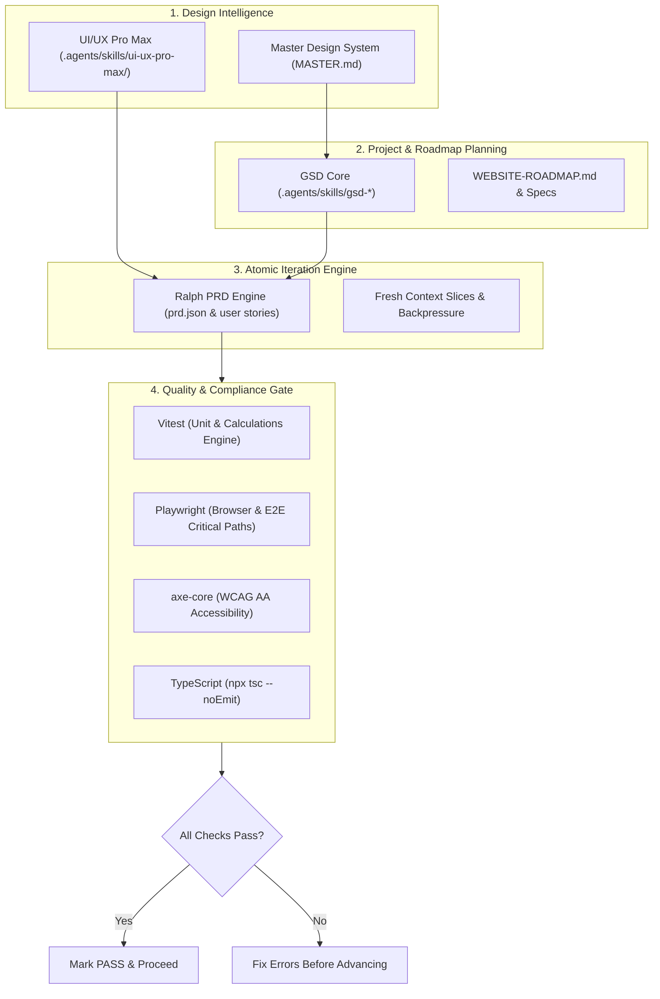

# BanksCart – Advanced AI Development Workflow

> **Status:** Production Architecture Blueprint  
> **Target Environment:** Antigravity IDE & CLI with GSD Core, Ralph Pattern, and UI/UX Pro Max

---

## 1. Executive Summary & Tool Hierarchy

The BanksCart development workflow unites four specialized engineering layers into an integrated, non-conflicting software development lifecycle:



---

## 2. Distinct Roles & Separation of Concerns

### A. UI/UX Pro Max (Design Intelligence)
- **Location:** `.agents/skills/ui-ux-pro-max/`
- **Primary Function:** High-precision fintech ergonomics, typography hierarchy, responsive breakpoints, comparison matrix UX, and accessible colour pairings.
- **Rules of Engagement:**
  - Must strictly implement the approved palette from `design-system/bankscart/MASTER.md` (Deep Slate `#0F172A`, Trust Navy `#1E3A8A`, Gold `#A16207`, Emerald `#059669`).
  - Container width must uniformly remain `max-w-7xl mx-auto px-4 sm:px-6 lg:px-8`.
  - All numerical currency metrics must be rendered with `tabular-nums font-mono`.

### B. GSD Core (Project Planning & Milestone Governance)
- **Location:** Project-local installation in `.agents/` (`.agents/skills/gsd-*`, `.agents/mcp_config.json`, `.agents/settings.json`)
- **Primary Function:** Macro-level specification, milestone breakdown, codebase exploration, dependency mapping, and pre-release verification.
- **Key Commands & Skills:**
  - `/gsd-map-codebase` — Inspects component dependencies and shared routes.
  - `/gsd-plan-phase` — Structures milestone scope before code changes begin.
  - `/gsd-verify-work` — Runs multi-check automated audits prior to milestone sign-off.
  - `/gsd-code-review` — Enforces clean code boundaries and architectural guidelines.

### C. Ralph Pattern (Atomic User Story Execution)
- **Location:** `scripts/ralph/` (`prd.schema.json`, `ralph-runner.cjs`, `template.prd.json`)
- **Primary Function:** Micro-level atomic task slicing. Breaks complex pages into discrete, testable stories that fit into a single context window.
- **Key Concepts:**
  - **Single Story Focus:** The agent implements exactly one user story per iteration.
  - **Backpressure Mechanism:** A story cannot be marked as complete (`passes: true`) unless all automated checks (`npm test`, `npx tsc --noEmit`) pass with 0 errors.
  - **External Memory:** Context is kept clean; progress is tracked via `prd.json` and `progress.txt`.

### D. Automated Quality Gate
- **Unit Testing:** Vitest (`npm test`) validates mathematical compounding, EMI calculators, and tax slab engines in `tests/unit/`.
- **Type Safety:** TypeScript (`npx tsc --noEmit`) ensures strict interface integrity.
- **Accessibility:** `axe-core` via `@axe-core/playwright` audits WCAG 2.1 AA compliance.
- **E2E Testing:** Playwright (`npm run test:e2e`) verifies critical applicant journeys.

---

## 3. Compatibility Limitations & Safe Antigravity Integration

### Upstream Ralph Compatibility Notice
> [!IMPORTANT]
> The upstream `snarktank/ralph` shell script (`ralph.sh`) is designed to invoke Claude Code (`claude -p "..."`) or Amp CLI (`amp run ...`) in a continuous bash while-loop. It **does not natively support direct invocation of the Antigravity IDE agent**.
> 
> Running unvetted external bash loops that execute autonomous git commits or pushes violates BanksCart's safety rules.

### How BanksCart Resolves This Limitation
Instead of running an incompatible shell loop, we utilize the **BanksCart Ralph Adapter** (`node scripts/ralph/ralph-runner.cjs`):
1. **Interactive Control:** The Antigravity agent or developer inspects the next pending user story using:
   ```bash
   node scripts/ralph/ralph-runner.cjs next
   ```
2. **Implementation:** The Antigravity agent executes the required code change with full awareness of `MASTER.md` and UI/UX Pro Max guidelines.
3. **Automated Verification:** The runner validates the change:
   ```bash
   node scripts/ralph/ralph-runner.cjs verify
   ```
4. **Zero Accidental Deploys:** The adapter enforces that code is never deployed or pushed to remote repositories autonomously.

---

## 4. End-to-End Recommended Workflow

When implementing any page or feature from `WEBSITE-ROADMAP.md`:

```
1. Plan Milestone (GSD)  -->  2. Research Design (UI/UX)  -->  3. Slice Stories (Ralph)
           |                              |                               |
           v                              v                               v
    Define Scope                  Check MASTER.md                  Generate prd.json
    
4. Implement Story       -->  5. Automated Verification   -->  6. Sign-off & Next Story
           |                              |                               |
           v                              v                               v
    Single Target File             Vitest + Typecheck              Update prd.json status
```

1. **Phase Orientation:** Use GSD Core to review the milestone scope in `IMPLEMENTATION-PLAN.md`.
2. **Design Strategy:** Use UI/UX Pro Max to review responsive layout requirements and tokens.
3. **Task Definition:** Ensure the target page has a structured entry in `prd.json`.
4. **Execution:** Modify only the files assigned to that story.
5. **Backpressure Check:** Run `npm test && npx tsc --noEmit`.
6. **Mark Passing:** Verify completion with `node scripts/ralph/ralph-runner.cjs verify`.
