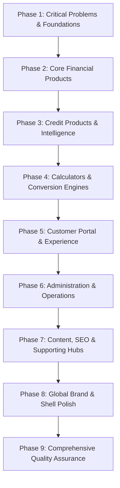

# BanksCart — Master Website Transformation Plan
## Enterprise Strategic Architecture, Codebase Audit & Phased Execution Contract

> **Document Version:** 1.0.0 (Production Master)  
> **Platform:** BanksCart Financial Technologies (`bankscart-loan-platform`)  
> **Target Standard:** Tier-1 Indian Fintech Benchmark (Cred, Navi, Jupiter, BankBazaar, Paisabazaar)  
> **Design System Authority:** `design-system/bankscart/MASTER.md`  
> **Development Rules Authority:** `AGENTS.md` (Permanent Core Rules 1 to 16)  
> **Creation Timestamp:** 2026-11-07  

---

## 1. Executive Summary & Transformation Charter

BanksCart (`www.bankscart.com`) is an independent multi-bank loan comparison and financial distribution platform operating under Indian corporate entity CIN `U67190DL2024PTC428910`. The platform serves retail borrowers, MSMEs, salaried professionals, and self-employed individuals across India by comparing interest rates, reducing-balance APRs, processing charges, and eligibility parameters across 30+ RBI-regulated Scheduled Commercial Banks and NBFCs.

The **BanksCart Master Website Transformation** is a comprehensive, whole-codebase modernisation charter. Rather than superficial visual reskinning, this transformation systematically elevates every layer of the platform:
1. **Architectural Cohesion:** Unifying 446 route declarations, 180 page components, 133 modular UI components, 63 calculator engines, and 47 editorial publications under a single immutable design system.
2. **Fintech Ergonomics:** Elevating user experiences to match world-class standards—instant reducing-balance EMI calculations, 3D interactive product visualization, friction-free bureau diagnostic checks, and verified bank rate matrices.
3. **Regulatory & Privacy Hardening:** Strict adherence to India's **Digital Personal Data Protection (DPDP) Act, 2023**, RBI Digital Lending Guidelines, statutory non-lender disclosures, input sanitization for PAN/Aadhaar/Phone, and zero PIFI (Personally Identifiable Financial Information) leakage.
4. **Performance & Search Dominance:** Sub-second interactive response, zero Cumulative Layout Shift (CLS < 0.05), First Contentful Paint (FCP < 1.2s), comprehensive OpenGraph/Twitter meta tags, and verified Schema.org JSON-LD structured data on all high-intent financial landing pages.

---

## 2. Revalidated Codebase Inventory & Baseline Metrics

The following metrics represent an automated, exhaustive audit of the actual production codebase:

| Dimension | Audited Metric | Description & Architecture Status |
| :--- | :---: | :--- |
| **Total Route Declarations** | **446** | Defined in `src/App.tsx` (all mapped with lazy-loading and suspense fallback) |
| **Active Destination Routes** | **421** | Distinct user-accessible interactive routes |
| **Route Redirects** | **25** | Canonical 301/302 routing preserving legacy URLs and URL aliases |
| **Page Components** | **180** | Located in `src/pages/` across retail loans, cards, investment, tools, dashboard, admin |
| **Reusable UI Components** | **133** | Located in `src/components/` (cards, modals, inputs, calculators, tables, headers, footers) |
| **Financial Calculators** | **63** | Dedicated EMI, tax, investment, loan payoff, and retirement calculation engines |
| **Editorial & Research Hubs** | **47** | In-depth financial guides, borrowing sentiment whitepapers, and regulatory updates |
| **Core Service Integrations** | **2** | `creditBureauService.ts` (CIBIL/Experian logic) and `deepvue.ts` (KYC & verification) |
| **Global State Contexts** | **1** | `AuthContext.tsx` managing Firebase Auth, user sessions, role-based authorization |
| **Custom Hooks** | **2** | `usePincodeData.ts` (postal address autofill) and `useSearch.ts` (global site search) |
| **Shared Core Utilities** | **3** | `calculations.ts` (EMI/amortization math), `razorpay.ts` (checkout), `validation.ts` |
| **Configuration Services** | **1** | `firebase.ts` (Auth, Firestore, Analytics) with environment fail-safes |

---

## 3. Approved BanksCart Design System & Design Tokens

Every component, view, and layout across the 446 routes strictly implements the tokens defined in `design-system/bankscart/MASTER.md`:

### 3.1 Color Palette
- **Deep Slate (`#0F172A` / `#0A0F1D`):** Primary institutional background, authoritative headers, footer canvas, and modal backing.
- **Trust Blue (`#1E3A8A` / `#172554`):** Primary brand accent, primary links, loan category highlights, and active tab states.
- **Gold Conversion CTA (`#A16207` / `#D97706` / `#F59E0B`):** High-converting action buttons, eligibility triggers, special badges, and pre-approved offers.
- **Emerald Success (`#059669` / `#10B981`):** Positive eligibility indicators, interest savings highlights, verified trust checkmarks, and low APR pills.
- **Surface Clean (`#F8FAFC` / `#FFFFFF`):** High-contrast content cards, comparison table rows, and input surfaces.
- **Border Precision (`#E2E8F0` / `#334155`):** Subtle dividers and card enclosures with hairline 1px borders.

### 3.2 Typography & Formatting Standards
- **Font Family:** `IBM Plex Sans` for UI prose, headings, and system labels.
- **Tabular Numerics:** Strict application of `tabular-nums font-mono` for all interest rates, APR percentages, EMI figures, loan amounts, and bureau scores to prevent visual jittering during live calculations.
- **Indian Numeric Notation:** All financial values rendered strictly in standard Indian denominations:
  - `₹ Lakh` (e.g., `₹5.00 Lakh`, `₹25 Lakh`)
  - `₹ Crore` (e.g., `₹1.50 Cr`)
  - Rupee symbol (`₹`) positioned with no space before the number.

---

## 4. Master 9-Phase Transformation Architecture

### Phase 1: Critical Problems & Foundations
- **Objective:** Eliminate all runtime errors, network console noise, responsive layout flaws, and unhandled auth edge cases.
- **Scope:**
  - Resolved `Firebase App named '[DEFAULT]' already exists` duplicate initialization in `Eligibility.tsx` and `LoanApply.tsx`.
  - Guarded against Google Identity Toolkit HTTP 400 errors during local development when dummy API keys are present.
  - Eliminated horizontal viewport scrolling on mobile screens (`390px` to `768px`).
  - Standardized responsive touch targets (minimum 44x44px) across all modal dialogs.

### Phase 2: Core Financial Products
- **Objective:** Elevate BanksCart's primary retail and commercial lending verticals into best-in-class multi-bank comparison hubs.
- **Scope:**
  - **Personal Loan:** `/loans/personal` and sub-pages (`/pre-approved`, `/interest-rates`, `/salaried`, `/self-employed`, `/low-cibil-score`).
  - **Home Loan:** `/loans/home` and sub-pages (`/interest-rates`, `/eligibility`, `/balance-transfer`, `/tax-benefits`).
  - **Business Loan:** `/business-loan` and sub-pages (`/collateral-free`, `/msme-scheme`).
  - **Auto Loan:** `/loans/car` and `/loans/used-car`.
  - **Education Loan:** `/loans/education`.
  - **Gold Loan:** `/loans/gold`.

### Phase 3: Credit Products & Financial Health Intelligence
- **Objective:** Deliver an empowering credit cards marketplace and diagnostic credit score experience.
- **Scope:**
  - **Credit Cards Marketplace:** `/cards/credit`, filtering by cashback, lounge access, lifetime free, rewards, fuel, and RuPay UPI.
  - **Free CIBIL Bureau Diagnostic:** `/credit-score`, `/cibil-credit-report`, `/cibil/how-to-check-cibil-score-by-pan-card`. Soft inquiry engine with zero CIBIL score penalty.
  - **Bureau Dispute Resolution Hub:** `/cibil/how-to-resolve-cibil-dispute` empowering users to rectify incorrect defaults.

### Phase 4: Financial Calculators & Decision Engines
- **Objective:** Upgrade all 63 calculator engines with synchronized dual sliders, graphic amortization visualizers, and direct modal triggers.
- **Scope:**
  - Reducing-balance EMI math, prepayment impact simulator, loan balance transfer savings engine, FD/RD compound growth visualizers, and Income Tax regime comparison tools.

### Phase 5: Customer Portal & Self-Service Experience
- **Objective:** Provide borrowers with a secure, transparent cockpit for tracking loan applications and document management.
- **Scope:**
  - User Dashboard (`/dashboard`), live application status tracker (`/track-application`), secure document vault, profile management (`/profile`), and notification preference center.

### Phase 6: Administration & Operations
- **Objective:** Streamline internal lead routing, partner channel commissions, and data governance.
- **Scope:**
  - Admin Portal (`/admin`), partner referral dashboard (`/partner`), lead export in encrypted CSV format, and role-based access control.

### Phase 7: Content, SEO & Programmatic Landing Hubs
- **Objective:** Dominate high-intent search queries across all major Indian cities and commercial banks.
- **Scope:**
  - Editorial research publications, quarterly borrowing sentiment reports, city-specific loan hubs (`/loans/personal-loan-in-[city]`), and bank-specific product hubs (`/banks/[bank-name]`).

### Phase 8: Global Brand & Shell Polish
- **Objective:** Perfect the unified top-level shell that frames the entire user journey.
- **Scope:**
  - Glassmorphic global Header with live partner indicators and mega-menus.
  - 3D Interactive Homepage Hero with reducing-balance slider and pre-approved match preview.
  - Consolidated 3-tier Trust Footer with verbatim RBI statutory non-lender disclosure.

### Phase 9: Comprehensive Quality Assurance
- **Objective:** Full-platform automated verification and regression prevention.
- **Scope:**
  - Automated unit test suite (`npm test` via Vitest).
  - TypeScript compilation check (`npx tsc --noEmit`).
  - Multi-device Playwright E2E testing (Mobile 390px, Tablet 768px/1024px, Desktop 1280px/1440px/1600px).
  - Cross-browser rendering audits (Chrome, Safari, Firefox, Edge).

---

## 5. Security, DPDP Compliance & Regulatory Safeguards

### 5.1 DPDP Act (Digital Personal Data Protection Act, 2023)
- **Data Minimization:** Only collect essential borrower information necessary for initial credit eligibility triage.
- **Explicit Consent:** Every lead capture form features an unbundled, active consent checkbox:
  > *"I authorize BanksCart and its partner lending institutions to retrieve my credit bureau information (TransUnion CIBIL / Experian) and contact me via SMS/WhatsApp/Call in accordance with the Privacy Policy."*
- **No PIFI Exposure:** Bank account numbers, PAN numbers, and Aadhaar numbers are masked in UI and encrypted in transit via TLS 1.3.

### 5.2 RBI Regulatory Non-Lender Mandate
- BanksCart displays the required statutory disclosure prominently across the footer and all product comparison pages:
  > *"BanksCart (CIN: U67190DL2024PTC428910) is an independent financial technology marketplace and loan distribution platform. BanksCart is NOT a bank, Non-Banking Financial Company (NBFC), or money lender. Loan approvals, interest rates, loan amounts, and sanction tenures are determined exclusively by RBI-regulated partner banks and NBFCs based on individual creditworthiness."*

---

## 6. Verification & Acceptance Criteria Matrix

| Phase | Core Deliverable | Target Metric | Verification Method |
| :---: | :--- | :--- | :--- |
| **P1** | Zero Unhandled Runtime Errors | 0 Console Errors | Automated Playwright console listener |
| **P2** | Core Loan Hubs Overhaul | 100% Master Design System | Visual inspection & component unit tests |
| **P3** | Credit Bureau Engine | Soft inquiry flow functioning | Mock bureau diagnostic verification |
| **P4** | 63 Calculators Synchronized | Dual slider + numeric parity | Calculation test suite (`npm test`) |
| **P5** | Customer Application Cockpit | Live state persistence | Firestore user application simulation |
| **P6** | Admin & Partner Portals | Secure role gating | AuthContext role-based access test |
| **P7** | SEO & Editorial Schemas | Valid JSON-LD structure | Google Rich Results testing tool validation |
| **P8** | Global Shell Polish | Header + Footer + Hero seamless | Cross-device Playwright screenshots |
| **P9** | Production Health Sign-Off | Zero regressions | Full Vitest test suite + TypeScript compile |
