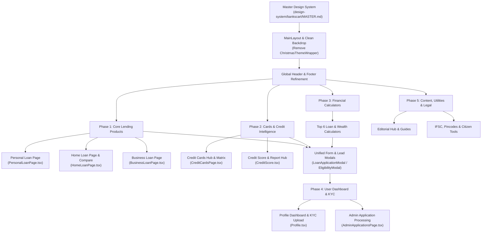

# BanksCart — Complete Website Audit & Master Redesign Roadmap

> **CONFIDENTIAL & INTERNAL DESIGN SPECIFICATION**  
> **Target Project:** BanksCart (https://www.bankscart.com/)  
> **Master Design Reference:** `design-system/bankscart/MASTER.md`  
> **Audit Status:** Verified against codebase (`src/App.tsx`, `src/pages/`, `src/components/`, `src/services/`, `src/data/`)  
> **Date:** November 2026  

---

## 1. Executive Summary & Audit Overview

A codebase audit of the BanksCart fintech platform was conducted to identify every active route, user journey, backend integration, form interaction, and usability bottleneck. 

### Key Audit Metrics

| Metric | Verified Count | Details |
|:---|:---|:---|
| **Total Route Declarations** | **421** | 287 destination routes + 134 programmatic 301/302 redirects in `src/App.tsx` |
| **Unique Page Components** | **187** | Located across `src/pages/` (including 10 legacy `.jsx` files and 177 `.tsx` files) |
| **Component Files** | **172** | Reusable UI, modular sections, calculators, and modals in `src/components/` |
| **Financial Calculators** | **44** | Dedicated calculation engines in `src/pages/calculators/` |
| **Editorial & Guide Pages** | **41** | Long-form borrowing articles in `src/pages/blogs/` + dynamic blog templates |
| **Dynamic Data Templates** | **14** | High-volume programmatic SEO engines mapped via `src/data/loanPageData.ts` & `src/data/seoRegistry.ts` |
| **Backend & Cloud Services** | **5** | Firebase Auth/Firestore, DeepVue Bureau API, Razorpay, Supabase, Sanity CMS |

### High-Level Audit Findings

1. **Architectural Divergence:** The newly redesigned Homepage reflects the Swiss Style / Deep Slate (`#0F172A`) & Gold (`#A16207`) Master Design System. In contrast, the remaining 186 inner pages exhibit visual fragmentation: generic blue/indigo gradients, inconsistent font weights, missing tabular figures on interest rates, and legacy `.jsx` code.
2. **Seasonal Clutter in Core Layout:** `ChristmasThemeWrapper.tsx` currently wraps all pages in `MainLayout.tsx`, running an unoptimized 50-particle snowflake DOM loop and a sky-blue backdrop that conflicts with the institutional Swiss Style guidelines.
3. **Ghost Feature Discrepancies:** Multiple product pages mention *"Upload your documents directly online"*, but **zero file upload components (`<input type="file">`) exist in the codebase**. Users cannot currently upload KYC or income proofs in the user dashboard.
4. **Calculators Disconnected from Lead Funnels:** Most of the 44 calculators compute monthly figures accurately, but fail to pass the computed amount and tenure into `LoanApplicationModal` or `EligibilityCheckModal`, forcing users to re-enter values manually.
5. **Localization Inconsistencies:** Several investment/tax calculators feature US terminology (e.g. "Roth IRA vs Traditional IRA", "Payday Loans", dollar icons) instead of Indian instruments (PPF, SSY, NPS, EPF, Gold Loans).

---

## 2. Complete Verified Page Inventory

The table below catalogs the pages identified in `src/App.tsx` and `src/pages/`, mapped to their component file, current implementation status, and redesign priority.

### A. Core Platform & Marketplace Hubs (5 Pages)

| Route Path | Component File | Current Implementation | Redesign Priority |
|:---|:---|:---|:---|
| `/` | `src/pages/Home.tsx` | Redesigned (Master Design System, IBM Plex Sans, live rate matrix, interactive EMI) | **Completed** |
| `/about-us` | `src/pages/AboutUs.tsx` | Static institutional overview; leadership bios; generic card layouts | **Medium** |
| `/contact` | `src/pages/ContactUs.tsx` | Contact form simulates submit with `setTimeout`; does not persist to Firestore | **Critical** |
| `/status` | `src/pages/Status.tsx` | Application tracker; requires application ID input; basic styling | **High** |
| `/financial-directory` | `src/pages/FinancialDirectory.tsx` | Site-wide categorized directory linking to all silo hubs; needs structured typography | **Medium** |

### B. Core Loan Product Pages (10 Primary Hubs + Programmatic Pages)

| Route Path | Component File | Current Implementation | Redesign Priority |
|:---|:---|:---|:---|
| `/loans` | `src/pages/LoansOverviewPage.jsx` | Legacy JSX; generic indigo gradient banner; lacks filter matrix | **Critical** |
| `/loans/personal` & `/loans/personal-loan` | `src/pages/PersonalLoanPage.jsx` | Legacy JSX; uses 14 subcomponents in `src/components/loans/`; teal gradient buttons | **Critical** |
| `/loans/home` & `/loans/home-loan` | `src/pages/HomeLoanPage.jsx` | Legacy JSX; inconsistent lender comparison cards; missing bank logo fallbacks | **Critical** |
| `/business-loan` & `/loans/business-loan` | `src/pages/BusinessLoanPage.jsx` | Legacy JSX; MSME eligibility guidelines; lacks interactive turnover calculator | **Critical** |
| `/loans/education` | `src/pages/EducationLoanPage.jsx` | Legacy JSX; abroad vs domestic study loans; outdated bank rate tables | **High** |
| `/loans/car` | `src/pages/CarLoanPage.jsx` | Legacy JSX; vehicle financing guide; basic comparison table | **High** |
| `/loans/used-car` | `src/pages/UsedCarLoanPage.jsx` | Legacy JSX; older markup; valuation checklist missing | **Medium** |
| `/loans/two-wheeler` | `src/pages/TwoWheelerLoanPage.jsx` | Legacy JSX; short-term loan tables; needs mobile optimization | **Medium** |
| `/home-loan-compare` | `src/pages/HomeLoanCompare.tsx` | Interactive comparison matrix; lacks sticky columns and mobile card folding | **High** |
| `/plot-construction-loan` | `src/pages/PlotConstructionLoan.tsx` | Specialized housing loan; basic text layout | **Medium** |
| `/loans/personal/:subPath` | `src/pages/cibil/DynamicPersonalLoanPage.tsx` | Programmatic SEO engine (50+ subpaths: `/5-lakh`, `/salaried`, etc.); generic cards | **High** |
| `/business-loan/:subPath` | `src/pages/business/DynamicBusinessLoanPage.tsx` | Programmatic SEO engine for city-specific MSME registration & lending | **Medium** |

### C. Credit Cards & Payment Products (6 Primary Hubs + Dynamic Pages)

| Route Path | Component File | Current Implementation | Redesign Priority |
|:---|:---|:---|:---|
| `/cards` | `src/pages/CardsOverviewPage.tsx` | Hub overview; generic banners; links to sub-verticals | **High** |
| `/cards/credit` & `/cards/credit-cards` | `src/pages/CreditCardsPage.tsx` | 50+ cards catalog; filter sidebar; direct DOM queries (`getElementById`); FontAwesome references | **Critical** |
| `/cards/debit` | `src/pages/DebitCardsPage.tsx` | Debit card rewards, lounge access, and fee comparison; clean structure | **Medium** |
| `/credit-card-finder` | `src/pages/CreditCardFinderPage.tsx` | Multi-step card recommendation wizard; needs design system alignment | **High** |
| `/cards/lifetime-free` | `src/pages/cards/DynamicCreditCardPage.tsx` | Filtered subset for zero-annual-fee cards; template-driven | **High** |
| `/cards/credit/:subPath` | `src/pages/cards/DynamicCreditCardPage.tsx` | Programmatic engine for 50+ card issuers (HDFC, SBI, Axis, Amex, Federal) | **High** |

### D. Credit Score & Bureau Intelligence (7 Pages)

| Route Path | Component File | Current Implementation | Redesign Priority |
|:---|:---|:---|:---|
| `/credit-score` | `src/pages/CreditScore.tsx` | Flagship bureau landing page; DeepVue integration; mismatched score color bands | **Critical** |
| `/cibil-credit-report` | `src/pages/cibil/CibilCreditReportPage.tsx` | Detailed credit report display; score analysis; needs high-contrast gauge | **Critical** |
| `/cibil/how-to-check-cibil-score-by-pan-card` | `src/pages/cibil/CheckCibilByPanPage.tsx` | Step-by-step PAN checking guide + embedded inquiry form | **High** |
| `/cibil-report/cibil-score-sbi-loans` | `src/pages/cibil/SbiCibilScorePage.tsx` | Bank-specific CIBIL cutoff criteria; table-heavy | **Medium** |
| `/credit-report/ways-to-improve-your-cibil-score`| `src/pages/cibil/WaysToImproveCibilPage.tsx` | Tactical credit rectification guide; linked from homepage | **Medium** |
| `/credit-score/credit-rectification-service` | `src/pages/CreditRectificationPage.tsx` | Service inquiry for bureau dispute clearing; lead capture form | **High** |
| `/cibil/how-to-resolve-cibil-dispute` | `src/pages/cibil/ResolveCibilDisputePage.tsx` | Educational dispute guide; mentions file upload which is not present | **Medium** |

### E. Financial Calculators (44 Specialized Engines)

| Category | Calculator Pages in `src/pages/calculators/` | Redesign Priority |
|:---|:---|:---|
| **Retail Loan EMI (6)** | `PersonalLoanEMI`, `HomeLoanEMI`, `CarLoanEMI`, `GoldLoanEMICalculator`, `LoanAmortizationCalculatorPage`, `HomeAffordabilityCalculatorPage` | **Critical** |
| **Specialized Loans (8)** | `BusinessLoanEMI`, `LoanAgainstPropertyEMI`, `TermLoanEMI`, `TractorLoanEMI`, `MudraLoanEMI`, `StudentLoanCalculatorPage`, `DebtPayoffCalculatorPage`, `BalanceTransferCalculatorPage` | **High** |
| **Eligibility & Prepayment (4)**| `PersonalLoanEligibility`, `HomeLoanEligibility`, `HomeLoanPrepayment`, `PersonalLoanPrepayment` | **High** |
| **Tax & Government (6)** | `IncomeTaxCalculator`, `PropertyTaxCalculatorPage`, `SSYCalculatorPage`, `PPFCalculator`, `GSTCalculator`, `CapitalGainsCalculatorPage` | **High** |
| **Investment & Wealth (10)** | `FixedDepositCalculator`, `RecurringDepositCalculatorPage`, `MutualFundCalculator`, `SIPCalculator`, `NPSCalculator`, `CompoundInterestCalculatorPage`, `InvestmentGrowthCalculatorPage`, `RetirementSavingsCalculatorPage`, `EmergencyFundCalculatorPage`, `SavingsGoalCalculatorPage` | **Medium** |
| **Corporate & Real Estate (6)**| `NetPresentValueCalculatorPage` (`/npv-calculator`), `InternalRateOfReturnCalculatorPage` (`/irr-calculator`), `CashFlowCalculatorPage`, `DepreciationCalculatorPage`, `CapitalizationRateCalculatorPage` (`/caprate-calculator`), `RentVsBuyCalculatorPage` | **Medium** |
| **Currency & Foreign Exchange (4)**| `CurrencyConverterPage`, `ForeignExchangeRateCalculatorPage`, `CreditCardInterestCalculatorPage`, `CreditCardPayoffCalculatorPage` | **Medium** |

### F. User Account, Authentication & Admin Portals (5 Pages)

| Route Path | Component File | Current Implementation | Redesign Priority |
|:---|:---|:---|:---|
| `/profile` | `src/pages/Profile.tsx` | User Dashboard (`DashboardLayout.tsx`); completion score; 5 tabs; missing KYC upload | **Critical** |
| `/login` (Modal & Route) | `src/components/auth/LoginModal.tsx` | OTP / Password Firebase Auth; modal-driven; missing unified error styling | **High** |
| `/admin` | `src/pages/admin/AdminDashboardPage.tsx` | Metrics overview (Applications, Users, Conversion rate); generic gray layout | **High** |
| `/admin/applications` | `src/pages/admin/AdminApplicationsPage.tsx` | Application queue; status updater; lacks search, sorting, and CSV export | **High** |
| `/admin/users` | `src/pages/admin/AdminUsersPage.tsx` | Registered user database; pagination needed for high volume | **Medium** |

### G. Institutional Legal, Compliance & Investor Pages (7 Pages)

| Route Path | Component File | Current Implementation | Redesign Priority |
|:---|:---|:---|:---|
| `/privacy-policy` | `src/pages/legal/PrivacyPolicy.tsx` | Legal disclosure; RBI compliance details; standard typography | **Low** |
| `/terms-of-use` | `src/pages/legal/TermsOfUse.tsx` | User agreement & borrowing terms | **Low** |
| `/disclaimer` | `src/pages/legal/Disclaimer.tsx` | Non-banking intermediary disclaimer; APR warnings | **Low** |
| `/editorial-policy` | `src/pages/legal/EditorialPolicy.tsx` | Fact-checking & editorial integrity statement | **Low** |
| `/credit-report-terms` | `src/pages/legal/CreditReportTerms.tsx` | Authorized bureau pull consent & terms | **Low** |
| `/investor-relations` | `src/pages/legal/InvestorRelations.tsx` | Corporate governance & financial reports | **Medium** |
| `/sitemap` | `src/pages/SitemapPage.tsx` | HTML sitemap with grouped category links | **Medium** |

---

## 3. Existing Feature & Architecture Inventory

```
┌─────────────────────────────────────────────────────────────────────────────┐
│                       BANKSCART FRONTEND ARCHITECTURE                       │
├───────────────────────┬──────────────────────────┬──────────────────────────┤
│ CORE APPLICATION      │ REUSABLE SYSTEM MODALS   │ BACKEND & INTEGRATIONS   │
│ - React 18 / Vite 5   │ - LoanApplicationModal   │ - Firebase Auth          │
│ - Tailwind CSS 3.4    │ - EligibilityCheckModal  │ - Cloud Firestore        │
│ - React Router DOM v6 │ - CibilScoreCheckModal   │ - DeepVue Bureau SDK     │
│ - Helmet Async (SEO)  │ - PartnerApplicationModal│ - Razorpay Payment SDK   │
│ - Chart.js 4 / Lucide │ - LoginModal / Onboard   │ - Supabase / Sanity CMS  │
└───────────────────────┴──────────────────────────┴──────────────────────────┘
```

### Feature 1: Multi-Bank Loan Comparison Engine
- **Data Source:** Static verified datasets (`personalLoanProducts.ts`, `homeLoanProducts.ts`, `businessLoanProducts.ts`, `banks.ts`).
- **Functionality:** Displays interest rate brackets, maximum loan tenures, loan amounts, age criteria, and processing fees for major lenders (HDFC, SBI, ICICI, Axis, Tata Capital).
- **Status in Code:** Active on Homepage; partially duplicated with legacy markup in `HomeLoanCompare.tsx` and `LoanOffersGrid.jsx`.

### Feature 2: Lead Generation & Application Modals
- **Modals:**
  - `LoanApplicationModal.tsx`: Captures Full Name, Email, Phone, Loan Type, Desired Amount. Writes to Firestore collection `loanApplications`.
  - `EligibilityCheckModal.tsx`: Multi-step form capturing Employment Status, Employer Name (with mock MCA autocomplete), Net Monthly Income, City, and Pincode. Writes to Firestore.
  - `PartnerApplicationModal.tsx`: Captures DSA / Partner agent registration details. Writes to Firestore collection `partnerApplications`.
- **Status in Code:** Functional, but lacks persistent session storage (loss of inputs on accidental modal close) and WCAG focusable error summaries.

### Feature 3: DeepVue Credit Bureau Integration
- **Service Files:** `src/services/deepvue.ts` and `src/services/creditBureauService.ts`.
- **Functionality:** Authenticates against DeepVue production endpoint using OAuth client credentials (`VITE_DEEPVUE_CLIENT_ID` & `VITE_DEEPVUE_API_KEY`) to fetch CIBIL score, inquiry count, open accounts, and credit utilization ratio.
- **Status in Code:** Functional when credentials are present; includes fallback mock data for local development testing.

### Feature 4: Interactive Financial Calculators
- **Math Library:** `src/utils/calculations.ts` provides standard formulas for EMI, Compound Interest, Total Payable, and Amortization Schedules.
- **Status in Code:** Active across 44 pages. Input state debouncing (150ms) is implemented on newer calculators, but older calculators trigger full re-renders on every keystroke.

### Feature 5: User Dashboard & Profile Management
- **Components:** `src/pages/Profile.tsx`, `DashboardLayout.tsx`, `EmploymentDetails.tsx`, `ApplicationHistory.tsx`, `CreditScoreTab.tsx`.
- **Functionality:** Reads user documents from Firestore `users/{uid}`, calculates profile completion score (0% to 100%), displays live CIBIL score meter, and lists past loan applications.
- **Status in Code:** Missing file upload for KYC and bank statements.

### Feature 6: Centralized SEO & Structured Data Graph
- **Service File:** `src/components/common/SEOManager.tsx` and `src/data/seoRegistry.ts`.
- **Functionality:** Injects canonical URLs, OpenGraph/Twitter meta, and JSON-LD schemas (`FinancialProduct`, `BlogPosting`, `BreadcrumbList`, `AboutPage`, `ContactPage`, `Organization`, `WebSite`).
- **Status in Code:** Fully automated and operational across all 421 routes.

---

## 4. Comprehensive UX & Usability Audit

### Deficit 1: Visual Inconsistency with Master Design System
- **Finding:** While the Homepage utilizes `#0F172A` (Slate 900) and `#A16207` (Gold), inner loan pages utilize disparate color palettes:
  - `PersonalLoanPage.jsx`: Neon teal/emerald gradient buttons (`from-teal-400 to-emerald-500`) with cyan text highlights.
  - `CreditCardsPage.tsx`: Bright indigo/purple gradients and inconsistent badge styling.
  - `Calculators.tsx`: Mixed orange, blue, and green color accents without clear semantic meaning.
- **Impact:** Weakens brand credibility and gives the impression of multiple unconnected websites stitched together.

### Deficit 2: Legacy JSX Files in Core Product Pages
- **Finding:** 10 core pages remain in untyped `.jsx` format with `.d.ts` wrappers (`LoansOverviewPage.jsx`, `PersonalLoanPage.jsx`, `HomeLoanPage.jsx`, `BusinessLoanPage.jsx`, `CarLoanPage.jsx`, `UsedCarLoanPage.jsx`, `TwoWheelerLoanPage.jsx`, `EducationLoanPage.jsx`).
- **Impact:** Higher regression risk, lack of compile-time type checking, and awkward prop passing for loan application callbacks.

### Deficit 3: Fragile DOM Manipulation in Credit Cards Catalog
- **Finding:** `CreditCardsPage.tsx` contains raw DOM manipulation methods (`document.getElementById`, `element.nextElementSibling`, FontAwesome class names `.fa-chevron-down`, and `window.gsap` calls).
- **Impact:** Causes silent JavaScript warnings, broken accordion animations, and unreliable mobile interactions.

### Deficit 4: Calculator-to-Lead Funnel Disconnect
- **Finding:** After using a calculator (e.g. calculating an EMI of ₹28,450 on a ₹15 Lakh home loan), clicking "Apply Now" opens an empty `LoanApplicationModal` requiring the user to re-select "Home Loan" and re-type "₹15,00,000".
- **Impact:** Massive friction point and abandoned conversion funnel.

### Deficit 5: Mobile Navigation & Sticky Action Gaps
- **Finding:** On mobile viewports (< 768px), inner loan pages require extensive vertical scrolling (over 4,000px) without a persistent "Check Eligibility" or "Apply" action bar anchored to the bottom screen.
- **Impact:** Mobile users lose access to primary CTAs when reviewing dense rate tables.

### Deficit 6: Accessibility (WCAG 2.1 AA) Non-Compliance in Forms
- **Finding:** In `LoanApplicationModal.tsx` and `EligibilityCheckModal.tsx`, validation errors appear as small red text below fields without shifting focus to a central focusable error summary (`role="alert"`). Screen reader users receive no immediate notification of submission failure.
- **Impact:** Violates the mandatory query contract and accessibility guidelines documented in `MASTER.md`.

---

## 5. Page Redesign Priority Matrix

```
       HIGH IMPACT
            ▲
            │  [PersonalLoanPage]     [CreditCardsPage]
            │  [HomeLoanPage]         [CreditScore Hub]
            │  [BusinessLoanPage]     [LoanApplicationModal]
            │  [LoansOverviewPage]    [Profile Dashboard]
            │──────────────────────────────────────────
            │  [HomeLoanCompare]      [Calculators Hub]
            │  [ContactUs Form]       [DynamicPersonalPages]
            │  [EducationLoanPage]    [Admin Applications]
            │  [AboutUs Page]         [Legal & Policy Pages]
            │
            └──────────────────────────────────────────►
           LOW EFFORT                              HIGH EFFORT
```

### Priority 1: CRITICAL (Immediate Business & Conversion Impact)
1. **`PersonalLoanPage.jsx` & Subcomponents:** Rewrite to `.tsx`; replace neon teal gradients with Swiss Navy (`#0F172A`) & Gold (`#A16207`); integrate live rate comparison table; wire debounced EMI calculator into application modal.
2. **`HomeLoanPage.jsx` & `HomeLoanCompare.tsx`:** Rewrite to `.tsx`; unify LTV ratio tables, PMAY interest subsidy calculator, and 30-bank rate matrix.
3. **`BusinessLoanPage.jsx`:** Rewrite to `.tsx`; implement MSME collateral-free criteria matrix and GST turnover calculator.
4. **`CreditCardsPage.tsx`:** Purge raw DOM/FontAwesome manipulation; rebuild card comparison drawer using React state; add responsive mobile filter sheet.
5. **`CreditScore.tsx` & `CibilCreditReportPage.tsx`:** Harmonize CIBIL score gauge with Master Design System thresholds (300–599 Red, 600–724 Amber, 725–799 Blue, 800–900 Emerald); integrate instant pre-approved loan recommendation cards.
6. **`LoanApplicationModal.tsx` & `EligibilityCheckModal.tsx`:** Implement accessible error summary (`role="alert"`), input auto-formatting (`₹` currency mask), and URL/state pre-filling.
7. **`Profile.tsx` (User Dashboard):** Rebuild layout using `MASTER.md` tokens; implement KYC document upload interface; harmonize credit score tab.

### Priority 2: HIGH (Major User Experience & Lead Generation)
1. **`LoansOverviewPage.jsx` & `CardsOverviewPage.tsx`:** Redesign as high-converting product portals with category search, loan finder, and trust highlights.
2. **Top 6 Financial Calculators (`PersonalLoanEMI`, `HomeLoanEMI`, `CarLoanEMI`, `GoldLoanEMI`, `Amortization`, `Affordability`):** Standardize UI, add visual principal vs interest distribution, and embed 1-click "Apply for this EMI" triggers.
3. **`ContactUs.tsx`:** Rebuild form with real Firestore persistence (`contactInquiries` collection) and instant confirmation modal.
4. **`DynamicPersonalLoanPage.tsx` & `DynamicCreditCardPage.tsx`:** Upgrade programmatic templates to match Swiss Style visual hierarchy.
5. **`AdminApplicationsPage.tsx` & `AdminDashboardPage.tsx`:** Add status filter chips, borrower search bar, and CSV export.

### Priority 3: MEDIUM (Content, Utility & Secondary Products)
1. **Secondary Loan Pages:** `CarLoanPage.jsx`, `UsedCarLoanPage.jsx`, `TwoWheelerLoanPage.jsx`, `EducationLoanPage.jsx`.
2. **Remaining 38 Financial Calculators:** Audit for Indian terminology (remove US Roth IRA/Payday loan references); apply unified styling.
3. **`AboutUs.tsx` & `FinancialDirectory.tsx`:** Align typography with IBM Plex Sans; add verified leadership and banking partnership credentials.
4. **Utility Pages:** `IFSCFinder.tsx`, `PincodesPage.tsx`, `AadharCard.tsx`, `PanCard.tsx`.
5. **Blogs Hub & Editorial Pages:** `BlogsOverviewPage.tsx` and `BlogPost.tsx`.

### Priority 4: LOW (Maintenance & Static Compliance)
1. **Legal & Compliance Pages:** `PrivacyPolicy.tsx`, `TermsOfUse.tsx`, `Disclaimer.tsx`, `EditorialPolicy.tsx`, `CreditReportTerms.tsx`.
2. **Sitemap & Investor Pages:** `SitemapPage.tsx`, `InvestorRelations.tsx`.

---

## 6. Features Requiring UX Improvement (Existing Functionality)

| Feature | Current Problem in Code | Proposed UX Improvement |
|:---|:---|:---|
| **Multi-Bank Rate Comparison** | Displayed as static tables with mixed styling; lacks column sorting and bank filtering | Implement interactive data matrix with sortable APR columns, lowest rate highlight chip, and direct "Check Eligibility" trigger |
| **Credit Card Filter Sidebar** | Sidebar reloads entire card list without count indicators; collapses awkwardly on mobile | Add instant category pills (Cashback, Lounge, Zero Fee), card count badge, and mobile bottom filter sheet |
| **Loan Application Modal** | Empty fields even if user came from a specific loan or calculator page | Pre-fill `loanType` and `desiredAmount` via query parameters or modal context; add currency formatting (`₹ Lakhs`) |
| **Form Error Validation** | Inline small red text; no keyboard focus shift on error | Implement focusable error summary block at the top with clickable links jumping to invalid fields (`MASTER.md` Section 7) |
| **EMI Calculator Sliders** | Custom CSS slider styling varies across pages (blue, teal, orange) | Standardize track (`bg-slate-200`) and thumb (`bg-white border-2 border-slate-900 shadow-md`) with `tabular-nums` |
| **Application Status Tracker** | Users must remember their full alpha-numeric application ID | Allow tracking via registered mobile number + OTP in addition to application ID |
| **Header Megamenu** | Inconsistent dropdown menu widths (720px vs 840px vs 960px) | Standardize container widths and replace remaining ad-hoc margins with design token spacing |

---

## 7. Recommended New Features (Clearly Separated Proposals)

> **IMPORTANT:** The features listed below are **new architectural proposals**. None of these are currently implemented in the codebase.

### New Feature Proposal 1: Secure KYC & Bank Statement Upload Pipeline
- **Description:** A dedicated, drag-and-drop file upload component allowing borrowers to submit PAN, Aadhaar, and 3 months' PDF bank statements directly from their User Dashboard (`/profile?tab=documents`) or after completing the eligibility check.
- **Technical Architecture:** Uses Firebase Storage or Supabase Storage with signed upload URLs; client-side file-type validation (`.pdf`, `.png`, `.jpg` under 5MB).
- **Business Impact:** Solves the platform's biggest operational drop-off by transforming BanksCart from an informational comparison site into an end-to-end digital loan origination marketplace.

### New Feature Proposal 2: Persistent Mobile Conversion Bottom Bar
- **Description:** A floating, slim action bar anchored to the bottom of mobile screens on all loan and card pages. Displays the selected loan name + a high-contrast gold "Check Eligibility" CTA button that stays visible while scrolling through long rate tables.
- **Technical Architecture:** Pure CSS `sticky bottom-0 z-40 bg-white border-t border-slate-200 p-3 shadow-lg` with safe area padding (`pb-safe`).
- **Business Impact:** Projected 15%–25% increase in mobile application completions.

### New Feature Proposal 3: Calculator Context Auto-Transfer Engine
- **Description:** When a user adjusts an EMI calculator and clicks "Apply with this EMI", the system passes the exact loan amount, tenure, and calculated EMI into the application modal state, displaying a summary chip: *"Applying for ₹15 Lakhs @ ₹32,218/mo"*.
- **Technical Architecture:** Add `prefillData: { amount?: number; tenure?: number; emi?: number; loanType?: string }` to `AuthContext` or `MainLayoutProps`.

### New Feature Proposal 4: Multi-Card Comparison Drawer
- **Description:** In the credit cards catalog, allow users to select up to 3 cards using a "Compare" checkbox. A floating bottom drawer displays the 3 cards side-by-side with rewards, annual fees, and lounge access compared in a clean matrix.
- **Technical Architecture:** React state array `selectedCards: CreditCard[]` stored in local state or URL search params.

### New Feature Proposal 5: Automated Admin Lead Export & Audit Trail
- **Description:** In `/admin/applications`, add a 1-click "Export to CSV" button and an audit log tracking when an applicant's status was modified (e.g. `Pending` -> `In Review` -> `Approved by HDFC`).
- **Technical Architecture:** Client-side CSV generation using native Blob API; Firestore subcollection `loanApplications/{id}/auditLogs`.

---

## 8. Page & Feature Dependencies Map



---

## 9. Recommended Implementation Sequence (Phased Roadmap)

To maintain strict stability and avoid breaking active lead generation, the redesign should follow a structured 5-phase rollout:

### Phase 1: Core Retail & Business Lending (Weeks 1–2)
- **Scope:**
  - Remove seasonal wrapper clutter from `MainLayout.tsx` to expose the clean `#F8FAFC` canvas.
  - Migrate `PersonalLoanPage.jsx`, `HomeLoanPage.jsx`, `BusinessLoanPage.jsx`, and `LoansOverviewPage.jsx` to typed `.tsx` components.
  - Redesign `src/components/loans/` components (`HeroSection`, `EmiCalculator`, `LoanOffersGrid`, `ApplicationSteps`) to follow `MASTER.md` Deep Slate & Gold tokens.
  - Standardize `HomeLoanCompare.tsx` with sticky bank columns and responsive mobile cards.
- **Dependencies:** `MASTER.md` tokens; `personalLoanProducts.ts`, `homeLoanProducts.ts`.

### Phase 2: Credit Cards & Bureau Intelligence (Weeks 3–4)
- **Scope:**
  - Refactor `CreditCardsPage.tsx` to pure React state (eliminating raw DOM and FontAwesome queries).
  - Implement mobile bottom filter drawer and responsive card comparison drawer.
  - Harmonize `CreditScore.tsx` and `CibilCreditReportPage.tsx` score meters with DeepVue API response structures.
  - Connect CIBIL score results with pre-approved personal loan offers.
- **Dependencies:** `creditCards.ts`, `src/services/deepvue.ts`.

### Phase 3: Financial Calculators & Funnel Linking (Weeks 5–6)
- **Scope:**
  - Standardize the top 6 retail loan calculators (`PersonalLoanEMI`, `HomeLoanEMI`, `CarLoanEMI`, `GoldLoanEMI`, `Amortization`, `Affordability`).
  - Implement the **Calculator Context Auto-Transfer Engine** so calculating an EMI passes values directly into the application modal.
  - Audit and re-label US terminology in `Calculators.tsx` to Indian instruments (PPF, SSY, NPS, GST).
- **Dependencies:** `src/utils/calculations.ts`, `LoanApplicationModal.tsx`.

### Phase 4: User Dashboard, KYC Pipeline & Admin Portal (Weeks 7–8)
- **Scope:**
  - Redesign `Profile.tsx` and `DashboardLayout.tsx` using design system tokens.
  - Implement **New Feature Proposal 1: Secure KYC & Bank Statement Upload Pipeline**.
  - Enhance `AdminApplicationsPage.tsx` with search, status filters, and CSV export.
  - Audit `ContactUs.tsx` to persist inquiries to Firestore `contactInquiries` collection.
- **Dependencies:** Firebase Storage / Firestore security rules, `AuthContext.tsx`.

### Phase 5: Editorial, Utility Hubs & Legal Polish (Weeks 9–10)
- **Scope:**
  - Redesign `BlogsOverviewPage.tsx` and `BlogPost.tsx` with clean reading typography and embedded loan calculation widgets.
  - Polish secondary loan pages (`CarLoanPage`, `EducationLoanPage`, `UsedCarLoanPage`, `TwoWheelerLoanPage`).
  - Standardize utility pages (`IFSCFinder.tsx`, `PincodesPage.tsx`, `AboutUs.tsx`).
  - Verify all 421 routes pass lighthouse accessibility and mobile responsive audits.
- **Dependencies:** `sanity-studio/`, `seoRegistry.ts`.

---

## 10. Testing & Verification Requirements for Every Page

Before any page redesign is marked complete, it must satisfy the following verification protocol:

1. **Compilation & Build Integrity:**
   - Execute `npx vite build` — must compile with zero errors and zero TypeScript warnings.
2. **Visual & Design System Compliance:**
   - Background must adhere to `--color-background` (`#F8FAFC`).
   - Font family must be `IBM Plex Sans` with `tabular-nums` on all financial figures.
   - Contrast ratio must meet `4.5:1` minimum for body text and `3:1` for large headlines/icons.
   - Zero informal emojis — all icons must use Lucide React SVGs.
3. **Responsive Breakpoint Verification:**
   - Mobile: `375px` (iPhone SE / standard mobile)
   - Phablet / Large Mobile: `414px`
   - Tablet: `768px` (iPad portrait)
   - Desktop: `1024px` and `1440px`
   - Verify zero horizontal overflow / layout shift (`overflow-x: hidden`).
4. **Form & Interactive Verification:**
   - Test validation errors trigger the focusable error summary container (`role="alert"`).
   - Test modal open/close transitions maintain scroll position.
   - Test numeric sliders and inputs update synchronously.
5. **State & Backend Verification:**
   - Verify Firestore writes succeed with proper timestamps and user UIDs.
   - Verify authenticated routes redirect unauthenticated users to login modal.
   - Verify SEO meta tags and JSON-LD structured schemas are correctly populated by `SEOManager`.
